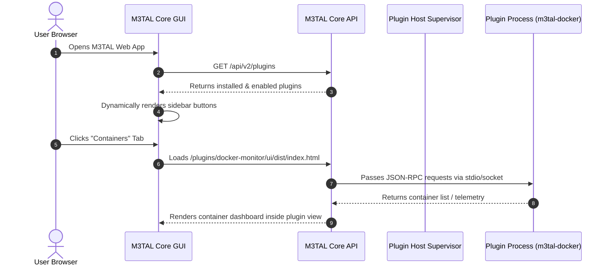

# M3TAL Plugin Standardization Specification

**Status**: Active Architecture Specification  
**Design Principle**: *"All code for said plugin lives with the plugin."*  
**Scope**: Core Platform Host, Process Supervisor, Dynamic UI Mounting, and Plugin Lifecycle

---

## 1. Architectural Principles

1. **Zero Hardcoded Core Footprint**:
   - The core M3TAL repository must never contain plugin-specific UI pages, models, or backend endpoints.
   - Core is purely the platform: Host Supervisor, System Monitor, Authentication, Process Manager, and Dynamic Plugin Host.
2. **Complete Self-Containment**:
   - Every plugin is an independent package containing its own manifest, backend executable, frontend UI bundle, RPC handlers, and configuration schemas.
3. **Canonical Process Naming**:
   - Every running plugin subprocess strictly follows the `m3tal-<plugin-name>` convention (e.g. `m3tal-docker`, `m3tal-ai`, `m3tal-smart`) enforced via Linux `prctl(PR_SET_NAME)` and isolated execution symlinks.
4. **Dynamic GUI Integration**:
   - The Web GUI dynamically discovers installed plugins and mounts their sidebar tabs, routing, and views at runtime without rebuilding the core frontend.
5. **Zero Resource Overhead When Uninstalled**:
   - If a plugin is not installed or is disabled, zero background processes run, zero sockets listen, and zero navigation items clutter the UI.

---

## 2. Standard Plugin Directory Layout

Every M3TAL plugin must adhere to the following directory structure:

```text
m3tal-<plugin-name>/
├── plugin.yaml                  # Mandatory: Plugin Manifest & Configuration
├── bin/
│   └── <executable>             # Backend executable (compiled Go/Rust/C binary or shell/python entrypoint)
├── ui/                          # Frontend User Interface
│   ├── dist/                    # Compiled static web bundle served by the plugin host
│   │   ├── index.html           # Main UI entrypoint
│   │   ├── assets/              # Bundled JS, CSS, images, and fonts
│   │   └── manifest.json        # UI metadata and route definitions
│   └── src/                     # Optional: React / Vue / HTML source files
├── config/
│   └── config.schema.json       # JSON Schema defining configurable settings
└── systemd/                     # Optional: Service units or system hooks (if applicable)
```

---

## 3. Standard Plugin Manifest (`plugin.yaml`)

The plugin manifest declaratively informs M3TAL Core how to execute the plugin, mount its UI, and route requests.

```yaml
apiVersion: m3tal.io/v1alpha1
kind: Plugin
metadata:
  name: docker-monitor
  version: 1.0.0
  title: "Containers"
  description: "Docker container fleet manager, log inspector, and lifecycle controller"
  author: "jakej985-rgb"
  license: "MIT"
  icon: "IconContainers"         # Standard M3TAL icon name or inline SVG string

spec:
  # 1. Process & Backend Execution
  command: "./bin/docker-plugin"
  args: []
  process_name: "m3tal-docker"   # Explicit canonical process name in system monitor
  poll_interval: 2s              # Collector execution cadence (if collector capability enabled)
  
  # 2. Declared Capabilities
  capabilities:
    - collector                  # Feeds live telemetry metrics into M3TAL Core
    - actions                    # Exposes JSON-RPC / REST actions (e.g. restart container)
    - ui_view                    # Provides a full dedicated page in the Web GUI
    - websocket_stream           # Emits streaming logs or live event feeds

  # 3. Dynamic Web GUI Mounting
  ui:
    entry: "ui/dist/index.html"  # Path to static HTML entrypoint
    route: "/containers"         # Front-end navigation path
    title: "Containers"          # Sidebar label
    sidebar: true                # Mount as a primary sidebar navigation item
    order: 20                    # Visual sorting priority in the sidebar
    roles: ["admin", "viewer"]   # Access control permissions

  # 4. IPC & Communication
  rpc:
    protocol: "jsonrpc-2.0"
    transport: "stdio"           # "stdio" or "unix_socket"
    socket_path: "/run/m3tal/plugins/docker.sock"

  # 5. Environment & System Requirements
  requirements:
    binaries: ["docker"]
    root: false                  # Whether root privileges are required
```

---

## 4. Dynamic UI Mounting Architecture

### 4.1. The Traditional Problem
Previously, pages like `Containers.jsx`, `Stacks.jsx`, and `AI.jsx` were hardcoded into the core `gui/src/App.jsx` router, creating tight coupling and requiring core app updates whenever a plugin changed.

### 4.2. The New Dynamic Mounting Model
Under the standardized model:
1. **Discovery**: On load, M3TAL Core GUI calls `GET /api/v2/plugins`.
2. **Mounting**: For each enabled plugin declaring `capabilities: ["ui_view"]`:
   - Core adds a navigation entry to the sidebar with `ui.title` and `metadata.icon`.
   - The plugin's pre-compiled web bundle (`ui/dist/*`) is served directly by the core HTTP server under `/plugins/<name>/`.
3. **Execution Frame**:
   - The plugin UI renders inside a seamless, borderless micro-frontend container (or sandboxed iframe) matching the M3TAL theme.
   - Core provides global state (active auth token, dark theme variables, WebSocket host) via postMessage or shared runtime bridge (`window.m3tal`).



---

## 5. Plugin IPC Protocol (JSON-RPC 2.0)

Plugins communicate with M3TAL Core over `stdio` or a local Unix socket using JSON-RPC 2.0:

| Method | Initiator | Payload | Purpose |
|---|---|---|---|
| `m3tal.init` | Core -> Plugin | `{ core_version, config }` | Handshake; validates capabilities and config. |
| `m3tal.collect` | Core -> Plugin | `{}` | Polls live metrics (CPU, RAM, container states). |
| `m3tal.action` | Core -> Plugin | `{ action, params }` | Executes an operation (e.g., `stopContainer`). |
| `m3tal.stream` | Plugin -> Core | `{ channel, data }` | Streams live events or logs to WebSocket clients. |
| `m3tal.shutdown` | Core -> Plugin | `{ reason }` | Graceful termination signal. |

---

## 6. Purge & Migration Roadmap

### Phase 1: Purge Bundled Plugins from Core (Immediate)
- Remove `plugins/docker-monitor/` from the core repository so no third-party plugin binaries or source code pollute the core engine.
- Verify core builds cleanly as a pure system monitor and platform supervisor.

### Phase 2: Dynamic Plugin Host & UI Loader
- Implement dynamic `/plugins/{name}/*` static file router in `api/server.go`.
- Update `gui/src/App.jsx` to dynamically render sidebar tabs and route views from `GET /api/v2/plugins` instead of hardcoded JSX pages.

### Phase 3: Externalize Plugins into Dedicated Repositories
- Create standalone repositories (e.g. `github.com/jakej985-rgb/m3tal-plugin-docker`).
- Package plugins as `.tar.gz` or `.deb` files downloadable via the M3TAL Plugin Registry catalog.
